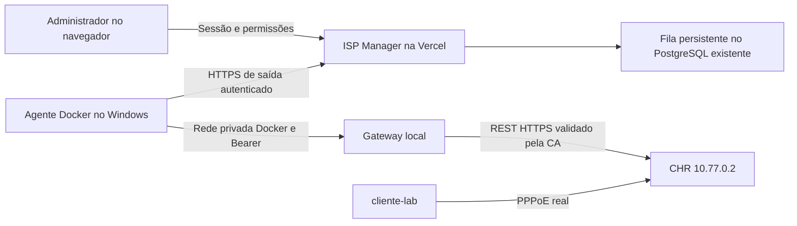

# Entrega da integração ISP Manager ↔ MikroTik

Validação em 23/10/2026, horário de Londres.

## Resultado em produção

- Painel: https://isp-manager-two.vercel.app/mikrotik (login existente obrigatório).
- Projeto Vercel existente: `isp-manager`, sem criar outro ISP Manager.
- Base usada: branch `feature/clientes-planos-financeiro`, originalmente `be6e622`.
- Código integrado à mesma branch pelo PR https://github.com/micheloliveira96/isp-manager/pull/3, merge `86a2f78`.
- Deployment funcional validado: `dpl_6BRuDsNHD1iK8rM3sK5Mc6DzUidy`, URL imutável `https://isp-manager-oidw3m6k3-micheloliveira96.vercel.app`.
- A aplicação local em `C:\GitHub\isp-manager` e suas alterações não commitadas foram preservadas. A implementação isolada fica em `C:\mikrotik-lab\isp-manager-vercel`.

## Arquitetura

O gateway publica somente `127.0.0.1:8088`. O agente não publica portas. A administração do CHR não foi exposta à internet. Senhas RouterOS ficam locais; senhas PPPoE na fila são cifradas, não retornam pela API de consulta e são descartadas após a confirmação/expiração.

## Funcionalidades entregues

- Cadastro de roteador/agente, chave única por roteador/empresa, rotação e desativação.
- Vínculo com clientes e planos já existentes, sem substituir dados comerciais.
- Criação real de secret PPPoE e perfil de velocidade.
- Alteração de senha, plano/perfil, bloqueio, desbloqueio e desconexão.
- Consulta de CPU, memória, versão, uptime, interfaces, usuários, perfis e sessões reais.
- Histórico de operações com estados de fila, execução, confirmação, expiração e resultado incerto.
- Controle de acesso por papel/permissão e isolamento por empresa no servidor e no banco.
- Idempotência, validação de propriedade do secret e confirmação persistente do agente.
- Estado de indisponibilidade sem métricas/sessões inventadas; dados atuais ocultos após 90 segundos sem comunicação válida.
- Painel em português, responsivo e com modo escuro.
- Assistente de configuração Windows e atalhos de iniciar/status/parar o agente.
- Automação financeira desativada. Preview não executa operações no roteador.

## Evidências

| Verificação | Resultado |
|---|---|
| TypeScript e lint dos arquivos da integração | Passaram |
| Build de produção local | Passou; avisos preexistentes fora da integração |
| Build de produção Vercel | `Ready` e promovido |
| Testes de segurança | 4 passaram: cifra autenticada, remoção de segredos, validade de snapshots e validação |
| Testes simulados do gateway | Passaram, incluindo senha, propriedade, duplicidade e auditoria sem senhas |
| 14 migrações em base isolada vazia | Todas aplicadas |
| Leitura real via gateway | Health, identidade, recursos, interfaces, endereços, filas, logs, sessões, perfis e secrets: HTTP 200 |
| Escrita ponta a ponta usando build de produção local e CHR real | Criação PPPoE, `100M/200M`, senha, bloqueio, desbloqueio, plano e desconexão confirmados; artefatos de teste removidos |
| Isolamento | Outra empresa não listou roteadores e recebeu HTTP 404 ao tentar provisionar no roteador alheio |
| Idempotência | Mesma chave/dados devolveu a mesma operação; chave com payload diferente recebeu HTTP 409 |
| Falha de comunicação | Snapshot atual removido e estado offline; durante desligamento do CHR, gateway informou indisponibilidade |
| Vercel → agente → gateway → CHR → Vercel | Job `cmvk77c830001l008iih2pdkj`: `SUCCEEDED`, código `CONFIRMED` |
| Telemetria recebida na Vercel | Identidade `chr-lab`, RouterOS `7.23.8 (long-term)`, CPU/memória/uptime reais e sessão `cliente-teste` em `10.78.0.200` |
| Agente e gateway | Ambos `healthy` |

Os testes de escrita utilizaram uma base de aplicação isolada e o CHR real, sem inventar registros comerciais na nuvem. Em produção, a fila foi validada com uma operação somente de consulta. Os testes não provam vazão de 200 Mbps na licença gratuita do CHR.

## Preservação dos dados e backups

Antes da migração, o backup cifrado da nuvem foi restaurado em schema exclusivo e comparado registro a registro: **119 registros em 18 tabelas**. A transação de migração conferiu as contagens originais e adicionou **3 tabelas**, sem apagar registros. Não havia `_prisma_migrations` na base existente; não foi criado um histórico fictício nem executado um reset.

Depois da integração, um segundo backup cifrado foi restaurado e comparado: **123 registros em 21 tabelas**. A diferença corresponde ao roteador, operação de verificação e seus registros de auditoria.

Backups em `C:\mikrotik-lab\backups`:

- `isp-manager-cloud-2026-10-22T23-47-12-463Z.encrypted.json`: antes da migração.
- `isp-manager-cloud-2026-10-22T23-58-13-117Z.encrypted.json`: depois da integração.
- `isp-manager-local-2026-10-22T23-27-20-057Z.dump`: banco local, formato PostgreSQL custom.
- Bundles Git do ISP Manager e gateway para recuperação do código.
- `mikrotik-cloud-keys.json`: chaves de recuperação, com acesso restrito ao usuário e SYSTEM.

As datas nos nomes dos arquivos usam UTC. Os snapshots VirtualBox incluem `antes-integracao-gateway-20261023` e `integracao-isp-base-validada-20261023`. O guia explica a diferença de credencial ao restaurar o primeiro snapshot.

A rotina temporária de manutenção não está no código final. Seus cinco deployments de teste foram removidos e suas variáveis de acesso temporário revogadas. O deployment antigo de produção anterior à integração foi preservado para rollback do código.

## Operação e limites

Para amanhã, use `C:\mikrotik-lab\LEIA-PRIMEIRO-ISP-MIKROTIK.md` e os atalhos `INICIAR-LAB-ISP.cmd`, `STATUS-ISP-MIKROTIK.cmd` e `CONECTAR-ISP-MIKROTIK.cmd`.

O computador, Docker Desktop e CHR precisam ficar ligados para o agente funcionar. Um secret habilitado não implica sessão ativa: o equipamento do cliente precisa autenticar. Usuários legados não são importados nem sobrescritos automaticamente. A sincronização de um perfil vale para novas autenticações; a troca individual de plano força reconexão.

Esta entrega trata da comunicação ISP Manager na Vercel ↔ MikroTik. Não inclui integração do NetVigia, SNMPv3, histórico de consumo por cliente, Simple Queues independentes, RADIUS ou automação por inadimplência. Essas capacidades permanecem como próximas etapas e não foram declaradas concluídas.
